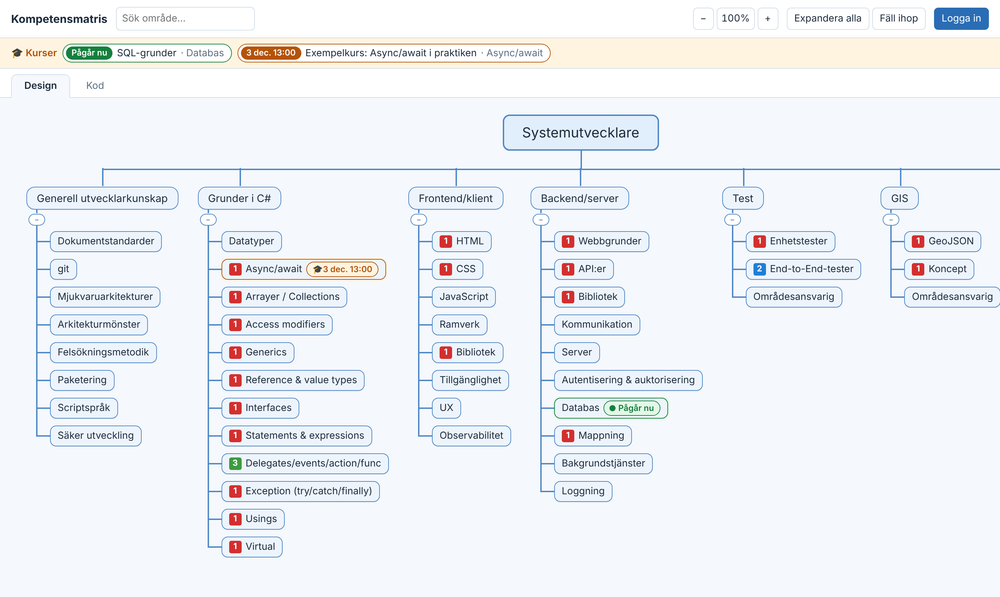

# Kompetensmatris

En enkel webbsida där man bygger upp och visar ett kompetensträd, till exempel **Systemutvecklare** med områden som *Grunder i C#*, *Backend/server* och *GIS*. Trädet ritas som en organisationskarta (som i MindManager) och vem som helst på intranätet kan titta. Administratörer loggar in med ett gemensamt lösenord och kan skapa, ändra, flytta och ta bort områden.

Om någon håller en **kurs** i ett område syns det direkt: rutan får en etikett med datum (eller **Pågår nu**), kursen visas i en remsa överst och ett klick öppnar en popup med en knapp **Anslut i Teams**.



## Funktioner

- **Träd som i MindManager**: roten överst, kategorierna bredvid varandra och underområdena under dem. Siffran under en ruta visar hur många underområden som är ihopfällda och ett klick fäller ut dem.
- **Prioritet 1/2/3** visas som röd, blå eller grön etikett före namnet.
- **Beskrivning och länkar** per område. Områden med innehåll är understrukna. Klicka på namnet för att läsa.
- **Kurser** med tid, kursledare, beskrivning och länk till Teams-mötet (eller motsvarande):
  - etikett på rutan (`🎓 3 dec. 13:00` eller `● Pågår nu`)
  - etikett med `↓` på ihopfällda rutor om en kurs finns längre ned i grenen
  - remsa överst med kommande och pågående kurser
  - popup med *Anslut i Teams* och *Lägg till i kalender* (.ics)
  - genomförda kurser göms under *Tidigare kurser*
- **Flera träd** (t.ex. en per roll), som man väljer i en meny när det finns fler än ett.
- **Sök**, **zoom** samt **expandera/fäll ihop alla**.
- **Kod-vy** (som i Visual Basic): hela trädet som indenterad text för att snabbt skriva in eller klistra in många rubriker.
- **Adminläge** med ett enda lösenord:
  - `+` lägger till ett underområde direkt i trädet. Skriv namnet och tryck Enter, sedan nästa.
  - Klistra in en **indenterad lista** i fältet för att skapa många områden på en gång (se nedan).
  - `✎` redigerar namn, prioritet, beskrivning, länkar och var området ligger.
  - `↑ ↓` / `← →` ändrar ordningen och `🗑` tar bort (med underområden och kurser).
  - **Exportera** och **Importera** all data som JSON (säkerhetskopia).
- Ljust och mörkt tema (följer datorns inställning) och fungerar i mobilen.

### Kod-vyn

Fliken **Kod** (eller <kbd>F7</kbd>, som *View Code* i Visual Basic; <kbd>Skift</kbd>+<kbd>F7</kbd> tillbaka till **Design**) visar hela trädet som text, en rad per område. Det är det snabbaste sättet att lägga in många rubriker på en gång:

```text
Systemutvecklare
  Grunder i C#
    [1] Async/await
    [1] Generics
  GIS
    [1] GeoJSON
    Kartor
      [2] Leaflet
```

- <kbd>Tab</kbd> drar in raden (den hamnar under raden ovanför), <kbd>Skift</kbd>+<kbd>Tab</kbd> flyttar ut den. Markera flera rader för att flytta alla.
- <kbd>Enter</kbd> ger en ny rad med samma indrag. <kbd>Ctrl</kbd>+<kbd>S</kbd> sparar.
- Medan du skriver visar sidan vad som kommer att hända, t.ex. *Osparat: 3 nya · 1 nytt namn · 1 tas bort*, eller vilken rad som är fel.
- Raderna matchas mot befintliga områden: samma namn är samma område, samma namn på en annan plats är en flytt, och en ändrad rad på samma plats är ett namnbyte. Beskrivning, länkar och kurser följer alltså med. Tar du bort rader frågar sidan först och visar vad som försvinner.
- Den som inte är inloggad ser koden skrivskyddad.

### Klistra in en lista

Varje rad blir ett område. Indrag (mellanslag eller tab) gör raden till ett underområde. `[1]`, `[2]` eller `[3]` först på raden blir prioritet. Punktlistetecken (`-`, `*`, `•`) tas bort. Det fungerar bra att kopiera en disposition från MindManager, Word eller Markdown.

```text
Frontend/klient
  [1] HTML
  [1] CSS
    Flexbox
    Grid
  JavaScript
    TypeScript
```

## Teknik

- **ASP.NET Core 10** (minimal API, C#, .NET 10 LTS som har stöd till november 2028). Ingen databas: allt sparas i **en JSON-fil** som skrivs om vid varje ändring. Den förra versionen sparas som `.bak`.
- **Vanlig HTML, CSS och JavaScript** i `wwwroot`. Inga ramverk och inget byggsteg.
- Inloggningen är avsiktligt enkel: lösenordet skickas i headern `X-Admin-Password` och jämförs med miljövariabeln `ADMIN_PASSWORD`. Läsning är öppen för alla. Det räcker på ett intranät men ger inget skydd mot någon som vill fuska.

```text
Dockerfile                     Bygger imagen (se nedan)
scripts/uppgradera.sh          Installerar, uppdaterar, backar och säkerhetskopierar i Docker
docker-compose.yml             Exempel på drift med Docker Compose (alternativ till skriptet)
src/Kompetensmatris/
  Program.cs                   API-endpoints, inloggningskontroll och PATH_BASE
  Models.cs                    Datamodell (noder, kurser) och all validering
  Outline.cs                   Tolkar inklistrade, indenterade listor
  DataStore.cs                 Läser och sparar JSON-filen
  SeedData.cs                  Exempelträdet som skapas vid första start
  wwwroot/                     index.html, app.js, style.css
tests/Kompetensmatris.Tests/   Integrationstester för API:t (xUnit)
demo/                          Demoversionen för claude.ai (ingår inte i Docker-bygget)
.github/workflows/docker.yml   Testar, bygger och publicerar imagen i GitHub Actions
```

## Installera och uppdatera hos oss

All data ligger i en Docker-**volym** (`kompetensdata`), som är skild från både containern och imagen. En ny version av appen är en ny image. Vid en uppdatering byter man container och kopplar in samma volym, så datan skrivs aldrig över.

Skriptet `scripts/uppgradera.sh` gör allt detta i ett kommando, både första gången och vid varje uppdatering. Det tar en säkerhetskopia, byter version, kontrollerar att appen svarar och backar automatiskt om den nya versionen inte fungerar.

### 1. Förutsättningar

- **En Linux-server med Docker** 20.10 eller nyare, samt `bash` och `git`. `curl` behövs för hälsokontrollen; utan curl tittar skriptet i loggen i stället. Användaren som kör skriptet måste få köra `docker`, alltså vara med i gruppen `docker` eller använda `sudo`.
  - På Windows: kör skriptet i WSL, eller använd kommandona under [Utan skriptet](#utan-skriptet-manuellt-eller-med-docker-compose). Docker Desktop ska köra **Linux-containrar**.
- **Nätverk vid bygget:** servern måste kunna hämta två basimager från Microsofts register `mcr.microsoft.com`:
  - `mcr.microsoft.com/dotnet/sdk:10.0` (bara för bygget, ca 1,3 GB på disk)
  - `mcr.microsoft.com/dotnet/aspnet:10.0` (grunden för den färdiga imagen)

  Själva bygget behöver **inget** annat nätverk: inga NuGet-paket och inga npm-paket. Det är provat med `docker build --network=none`.
- Går Docker genom en proxy hos er gäller det bara när basimagerna hämtas. Ställ då in proxyn för Docker, inte i Dockerfile:
  - Docker Desktop: *Settings → Resources → Proxies*
  - Linux: [Configure the daemon to use a proxy](https://docs.docker.com/engine/daemon/proxy/)
  - Gör proxyn TLS-inspektion måste organisationens rotcertifikat finnas i serverns certifikatlager.
- Får servern inte nå `mcr.microsoft.com` alls, se [Utan åtkomst till mcr.microsoft.com](#utan-åtkomst-till-mcrmicrosoftcom).

### 2. Hämta koden till servern

Till exempel till `/opt/kompetensmatris`:

```bash
git clone https://github.com/thjo100/kompetensmatris.git /opt/kompetensmatris
```

```bash
cd /opt/kompetensmatris
```

### 3. Installera första gången

```bash
scripts/uppgradera.sh 1.0.0
```

Första gången skapar skriptet filen `kompetensmatris.env` och stannar. Öppna filen och byt lösenordet:

```bash
nano kompetensmatris.env
```

```ini
ADMIN_PASSWORD=ett-eget-lösenord
```

I samma fil finns, bortkommenterat, det som behövs bakom en omvänd proxy och skriptets egna inställningar (se [Inställningar](#inställningar)). Filen innehåller lösenordet, så den kommer aldrig med i git och bara du kan läsa den.

Kör sedan skriptet igen:

```bash
scripts/uppgradera.sh 1.0.0
```

Skriptet bygger imagen `kompetensmatris:1.0.0`, startar containern `kompetensmatris` med volymen `kompetensdata` på port 8080 och väntar tills appen svarar. Öppna `http://<servern>:8080` och logga in med lösenordet. Första gången skapas exempelträdet *Systemutvecklare* och en exempelkurs, som du kan ändra eller ta bort i adminläget.

Containern startar om av sig själv om servern startas om (`--restart unless-stopped`).

### 4. Uppdatera till en ny version

```bash
cd /opt/kompetensmatris
```

```bash
git pull
```

```bash
scripts/uppgradera.sh 1.1.0
```

Versionsnumret väljer du själv. Det blir taggen på imagen och används när man backar, så öka det vid varje uppdatering (`1.0.0`, `1.1.0`, `1.2.0` …).

#### Så går en uppdatering till

1. **Bygger** imagen `kompetensmatris:1.1.0` från koden i katalogen. Senaste patchen av .NET 10 hämtas, med säkerhetsuppdateringar. Commit-hashen sparas som etikett i imagen.
2. **Säkerhetskopierar** datan till `backup/kompetensmatris-<datum>_<tid>.json`.
3. **Stoppar** den gamla containern och döper om den till `kompetensmatris-forra`. Den tas inte bort ännu.
4. **Startar** den nya versionen med samma volym, port och inställningar.
5. **Kontrollerar** att `/health` svarar `ok`, och väntar högst en minut.
6. **Svarar den:** den gamla containern tas bort och skriptet skriver ut hur man backar. Klart.
7. **Svarar den inte:** skriptet visar loggen och tar bort den nya containern. Datan läggs tillbaka från säkerhetskopian och den gamla versionen startas igen, så allt är som innan.

Appen är borta några sekunder medan containern byts. All data som redan skrivits in finns kvar, eftersom den ligger i volymen och inte i containern.

**Datan i nya versioner:** nya versioner läser alltid datafilen från tidigare versioner. Nya fält får standardvärden. Om en ändring kräver att datan får en ny form, läggs en automatisk omvandling in i koden och det står i pull requesten.

### 5. Backa till en tidigare version

Efter varje lyckad uppdatering skriver skriptet ut kommandot för att backa, till exempel:

```bash
scripts/uppgradera.sh --image kompetensmatris 1.0.0
```

Det fungerar som en vanlig uppdatering: säkerhetskopia, byte och hälsokontroll. De gamla imagerna finns kvar på servern (`docker images kompetensmatris`) tills någon tar bort dem.

Har den nyare versionen hunnit spara data med fält som den äldre inte känner till, kan de fälten försvinna när den äldre versionen sparar. Läs i så fall hellre tillbaka säkerhetskopian från före uppdateringen, se [Säkerhetskopior](#6-säkerhetskopior).

### 6. Säkerhetskopior

- **Automatiskt** före varje uppdatering, backning och återläsning.
- **När du vill:**

  ```bash
  scripts/uppgradera.sh --backup
  ```

- **Varje natt** med cron (`crontab -e` för en användare som får köra docker):

  ```cron
  15 2 * * * /opt/kompetensmatris/scripts/uppgradera.sh --backup >> /opt/kompetensmatris/backup.log 2>&1
  ```

Kopiorna hamnar i `backup/`. De 30 senaste sparas och äldre tas bort (`KM_BACKUP_KEEP`). Kopiera dem gärna även till en annan server eller en filresurs som säkerhetskopieras, eftersom katalogen ligger på samma disk som appen.

**Läsa tillbaka en säkerhetskopia:**

```bash
ls -lt backup/
```

```bash
scripts/uppgradera.sh --aterstall backup/kompetensmatris-2026-11-26_021500.json
```

Datan som finns just innan sparas först som en ny säkerhetskopia. Startar inte appen med filen, till exempel om den är trasig, läggs den tidigare datan tillbaka automatiskt.

Det går också att använda **Exportera** och **Importera** i adminläget.

### Inställningar

**`kompetensmatris.env`** skapas första gången och läses varje gång skriptet körs.

Inställningar för appen (skickas in i containern):

| Inställning | Beskrivning |
|-------------|-------------|
| `ADMIN_PASSWORD` | Lösenordet för adminläget. Måste sättas. |
| `ASPNETCORE_FORWARDEDHEADERS_ENABLED=true` | Bakom en omvänd proxy som sköter https, se [Bakom en omvänd proxy](#bakom-en-omvänd-proxy). |
| `PATH_BASE=/kompetens` | Under en undersökväg när proxyn inte tar bort prefixet. |

Inställningar för skriptet:

| Inställning | Standard | Beskrivning |
|-------------|----------|-------------|
| `KM_PORT` | `8080` | Port på servern. `127.0.0.1:8080` gör att bara en proxy på samma server når appen. |
| `KM_VOLUME` | `kompetensdata` | Volymen med datan, eller en katalog på servern som `/srv/kompetensmatris`. **Ändra den inte efter installationen:** en annan volym betyder en annan, tom datamängd. |
| `KM_CONTAINER` | `kompetensmatris` | Namnet på containern. |
| `KM_BACKUP_DIR` | `backup/` i katalogen | Var säkerhetskopiorna sparas. |
| `KM_BACKUP_KEEP` | `30` | Så många säkerhetskopior sparas. |
| `KM_IMAGE` | `kompetensmatris` | Namnet på imagen som byggs. |
| `DOTNET_REGISTRY` | `mcr.microsoft.com` | Intern spegel av Microsofts register vid bygget. |

Skriptets inställningar kan också sättas som miljövariabler, och då går de före filen, till exempel `KM_PORT=8081 scripts/uppgradera.sh 1.1.0`. Lägg dem hellre i filen, så blir de samma varje gång.

Har du ändrat en inställning i filen? Starta om med den version som redan är installerad, så används de nya inställningarna. Imagen byggs inte om:

```bash
scripts/uppgradera.sh --image kompetensmatris 1.1.0
```

Väljer du en katalog på servern i stället för en volym måste den ägas av användaren i containern (uid 1654):

```bash
sudo mkdir -p /srv/kompetensmatris
```

```bash
sudo chown 1654:1654 /srv/kompetensmatris
```

### Bakom en omvänd proxy

Containern talar bara http. Ska sidan nås med https, eller under ett eget namn, lägger man en omvänd proxy framför: IIS, nginx, Traefik, F5 eller liknande.

- Sätt `ASPNETCORE_FORWARDEDHEADERS_ENABLED=true` i `kompetensmatris.env`, så att appen förstår att besökaren kom via https. Proxyn ska skicka `X-Forwarded-Proto`, vilket de flesta gör som standard.
- Ligger proxyn på samma server kan du sätta `KM_PORT=127.0.0.1:8080`. Då når man appen bara via proxyn.
- **Under en undersökväg**, t.ex. `https://intranat/kompetens/`:
  - Proxyn tar bort `/kompetens` innan anropet når containern: ingen inställning behövs.
  - Proxyn skickar vidare med `/kompetens` kvar: sätt `PATH_BASE=/kompetens`.

Exempel för nginx med prefixet kvar:

```nginx
location /kompetens/ {
    proxy_pass http://127.0.0.1:8080;
    proxy_set_header Host $host;
    proxy_set_header X-Forwarded-Proto $scheme;
}
```

**Övervakning:** `GET /health` (eller `/kompetens/health` med `PATH_BASE`) svarar `ok`. Imagen har ingen `HEALTHCHECK`, eftersom den saknar curl, så övervaka adressen utifrån. Loggar: `docker logs kompetensmatris`.

### Från ändring till drift

1. En ändring görs på en gren, till exempel med Claude Code, och blir en pull request.
2. GitHub Actions kör testerna och bygger Docker-imagen i pull requesten.
3. Pull requesten mergeas till `main`.
4. På servern: `git pull` och `scripts/uppgradera.sh <ny version>`.

Vill ni hellre bygga imagen centralt, se [Färdig image från ett register](#färdig-image-från-ett-register).

### Färdig image från ett register

I stället för att bygga på servern kan imagen byggas på ett ställe och hämtas från Docker Hub eller ett internt register. Det kan vara Harbor, Artifactory, Nexus, Azure Container Registry eller liknande.

```bash
scripts/uppgradera.sh --image <konto>/kompetensmatris 1.1.0
```

Skriptet hämtar imagen om den inte redan finns på servern. Servern behöver då inte hela koden, bara skriptet: kopiera `scripts/uppgradera.sh` till exempelvis `/opt/kompetensmatris/scripts/`. Filen `kompetensmatris.env` och katalogen `backup/` hamnar i `/opt/kompetensmatris/`.

**Publicera manuellt:**

```bash
docker login
```

```bash
docker build --pull -t <konto>/kompetensmatris:1.1.0 .
```

```bash
docker push <konto>/kompetensmatris:1.1.0
```

**Publicera automatiskt till Docker Hub med GitHub Actions** (`.github/workflows/docker.yml`). Lägg till två hemligheter under *Settings → Secrets and variables → Actions* i GitHub-repot:

- `DOCKERHUB_USERNAME`: användarnamn eller organisation på Docker Hub
- `DOCKERHUB_TOKEN`: en *Personal access token* från Docker Hub (*Account settings → Personal access tokens*, behörighet *Read & Write*)

Flödet kör testerna och bygger imagen i varje pull request utan att pusha den. Det publicerar till Docker Hub i två fall:

- en push till `main` ger `<konto>/kompetensmatris:latest` och en tagg med commit-hashen
- en git-tagg som `v1.1.0` ger även `<konto>/kompetensmatris:1.1.0`, som sedan installeras med `--image <konto>/kompetensmatris 1.1.0`

```bash
git tag v1.1.0
```

```bash
git push origin v1.1.0
```

### Utan åtkomst till mcr.microsoft.com

**Intern spegel av MCR:** sätt `DOTNET_REGISTRY=<er-spegel>` i `kompetensmatris.env`. Bygget hämtar då `<er-spegel>/dotnet/sdk:10.0` och `<er-spegel>/dotnet/aspnet:10.0`.

**Helt utan nätverk:** bygg på en dator som har internet, flytta imagen som en fil och installera den med `--image`:

```bash
docker build --pull -t kompetensmatris:1.1.0 .
```

```bash
docker save kompetensmatris:1.1.0 -o kompetensmatris-1.1.0.tar
```

På servern:

```bash
docker load -i kompetensmatris-1.1.0.tar
```

```bash
scripts/uppgradera.sh --image kompetensmatris 1.1.0
```

**Bygger du på en Mac med Apple-processor för en vanlig server (x86-64)**, lägg till `--platform linux/amd64`:

```bash
docker buildx build --platform linux/amd64 --pull -t kompetensmatris:1.1.0 --load .
```

### Utan skriptet: manuellt eller med Docker Compose

Skriptet gör inget annat än vanliga Docker-kommandon. Samma uppdatering för hand:

```bash
docker build --pull -t kompetensmatris:1.1.0 .
```

```bash
docker cp kompetensmatris:/data/kompetensmatris.json ./kompetensmatris-backup.json
```

```bash
docker rm -f kompetensmatris
```

```bash
docker run -d --name kompetensmatris -p 8080:8080 -e ADMIN_PASSWORD=<lösenord> -v kompetensdata:/data --restart unless-stopped kompetensmatris:1.1.0
```

```bash
curl http://localhost:8080/health
```

**Med Docker Compose** (`docker-compose.yml`, byt lösenordet i filen först) räcker ett kommando både första gången och vid uppdatering. Volymen behålls:

```bash
docker compose up -d --build
```

Compose namnger volymen efter katalogen, till exempel `kompetensmatris_kompetensdata`. Välj antingen skriptet eller Compose och håll dig till det, så att datan alltid ligger i samma volym.

### Kommandon som raderar datan

Kör aldrig de här mot driftmiljön, de tar bort volymen med all data:

- `docker compose down -v` (det är `-v` som tar bort volymerna; `docker compose down` utan `-v` är ofarligt)
- `docker volume rm kompetensdata`
- `docker volume prune` eller `docker system prune --volumes`

## Konfiguration av appen

Miljövariabler som appen läser. Med skriptet sätts de i `kompetensmatris.env`.

| Miljövariabel    | Standard                        | Beskrivning                                  |
|------------------|---------------------------------|----------------------------------------------|
| `ADMIN_PASSWORD` | `admin`                         | Lösenordet för adminläget. **Byt det.** Loggen varnar om det inte är satt. |
| `DATA_PATH`      | `/data/kompetensmatris.json` i Docker (annars `data/kompetensmatris.json`) | Var datan sparas. |
| `PATH_BASE`      | tomt                            | Undersökväg, t.ex. `/kompetens`, när proxyn inte tar bort prefixet. |
| `ASPNETCORE_FORWARDEDHEADERS_ENABLED` | `false`    | Sätt `true` bakom en proxy som sköter https. |
| `TZ`             | `Europe/Stockholm` i Docker     | Tidszon. Kurstider sparas i UTC och visas i besökarens egen tidszon, så detta påverkar bara exempelkursen. |
| `ASPNETCORE_HTTP_PORTS` | `8080` i Docker          | Porten i containern. Ändra hellre porten på servern (`KM_PORT`). |

Imagen i korthet:

- grund: `mcr.microsoft.com/dotnet/aspnet:10.0` (Ubuntu 24.04)
- storlek: ca 350 MB
- port: 8080
- data: volym på `/data`
- användare: körs som `app` (uid 1654), inte root

## Felsökning

| Symptom | Orsak och åtgärd |
|---------|------------------|
| Skriptet säger *Den nya versionen startade inte eller svarade inte* | Felet står i loggen som skriptet visar. Den gamla versionen kör redan igen med oförändrad data. Rätta felet och kör skriptet igen. |
| Skriptet säger att `kompetensmatris-forra` finns kvar | En tidigare körning avbröts mitt i. Kör `kompetensmatris` och svarar: `docker rm kompetensmatris-forra`. Kör den inte: `docker rm -f kompetensmatris`, sedan `docker rename kompetensmatris-forra kompetensmatris` och `docker start kompetensmatris`. |
| *Docker svarar inte* | Docker kör inte, eller så får din användare inte använda det. Starta Docker, lägg till användaren i gruppen `docker` eller kör med `sudo`. |
| *Appen (uid 1654) får inte skriva i …*, eller `Access to the path '/data/kompetensmatris.json.tmp' is denied` i loggen | Datakatalogen på servern ägs av fel användare: `sudo chown -R 1654:1654 <katalogen>`. |
| Bygget fastnar eller misslyckas på `FROM mcr.microsoft.com/...` | Servern når inte Microsofts register. Kontrollera proxyinställningen för Docker, eller använd en spegel eller `docker save`/`docker load` (se ovan). |
| Datan är borta efter en uppdatering | Containern startades med en annan volym (`KM_VOLUME`, eller Compose i stället för skriptet). Datan finns kvar i den gamla volymen (`docker volume ls`) och i `backup/`. Rätta volymen och kör skriptet igen, eller läs tillbaka en säkerhetskopia. |
| `ADMIN_PASSWORD är inte satt` i loggen | Lösenordet är `admin`. Sätt `ADMIN_PASSWORD` i `kompetensmatris.env` och kör skriptet igen. |
| Sidan visas men trädet laddas inte under en undersökväg | Proxyn och `PATH_BASE` stämmer inte överens. Kolla att `.../kompetens/api/data` svarar och läs [Bakom en omvänd proxy](#bakom-en-omvänd-proxy). |
| Länkar och omdirigeringar blir `http://` fast sidan körs på `https://` | Sätt `ASPNETCORE_FORWARDEDHEADERS_ENABLED=true` och kontrollera att proxyn skickar `X-Forwarded-Proto`. |
| `port is already allocated` | Porten används redan på servern. Välj en annan med `KM_PORT=8081` i `kompetensmatris.env`. |
| `exec format error` | Imagen är byggd för fel processor, t.ex. på en Mac med Apple-processor. Bygg med `--platform linux/amd64`. |
| `bash\r: No such file or directory` | Skriptet har fått Windows-radslut. Klona om repot (filen `.gitattributes` ser till att det blir rätt) eller kör `sed -i 's/\r$//' scripts/uppgradera.sh`. |

## Utveckla utan Docker

Kräver [.NET 10 SDK](https://dotnet.microsoft.com/download).

```bash
ADMIN_PASSWORD=hemligt dotnet run --project src/Kompetensmatris
```

Öppna adressen som skrivs ut i terminalen. Datan hamnar i `src/Kompetensmatris/data/`. Ändringar i `wwwroot` syns direkt när du laddar om sidan.

```bash
dotnet test
```

## Demoversionen

`demo/` innehåller det som behövs för demon på claude.ai: samma gränssnitt, men med datan i artefaktens delade databas i stället för i servern. `python3 demo/build.py` skriver `demo/dist/kompetensmatris.html`. Den används inte av Docker-bygget.

## API

Alla ändrande anrop kräver headern `X-Admin-Password`.

| Metod  | Adress                    | Beskrivning                                        |
|--------|---------------------------|----------------------------------------------------|
| GET    | `/api/data`               | All data: `{ nodes: [...], courses: [...] }`       |
| POST   | `/api/login`              | `{ password }` → 204 om rätt, annars 401          |
| POST   | `/api/nodes`              | Skapa område `{ parentId, title, priority, description, links }` (`parentId: null` = nytt träd) |
| POST   | `/api/nodes/outline`      | Skapa många från text `{ parentId, text }`         |
| PUT    | `/api/nodes/{id}`         | Ändra område                                       |
| PUT    | `/api/trees/{id}`         | Kod-vyn: ersätt trädets struktur `{ nodes: [{ id, parentId, title, priority }] }` i dokumentordning |
| POST   | `/api/nodes/{id}/move`    | Flytta `{ parentId, index }`                       |
| DELETE | `/api/nodes/{id}`         | Ta bort område med underområden och kurser         |
| POST   | `/api/courses`            | Skapa kurs `{ nodeId, title, start, end, url, teacher, description }` |
| PUT    | `/api/courses/{id}`       | Ändra kurs                                         |
| DELETE | `/api/courses/{id}`       | Ta bort kurs                                       |
| PUT    | `/api/data`               | Importera (ersätter all data)                      |
